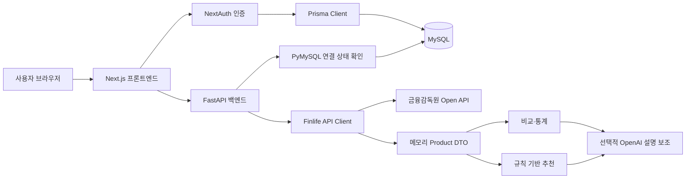

# finance-Airecommend 기술 구성 설명서

## 문서 목적

이 문서는 `finance-Airecommend` 프로젝트에서 실제로 사용한 기술과 각 기술의 역할을
설명한다. 프로젝트 소개와 실행 방법 중심의 기존 `README.md`와 달리, 이 문서는 기술을
선택한 이유와 프론트엔드, 백엔드, 데이터베이스, 외부 API가 연결되는 방식을 자세히 다룬다.

## 프로젝트 개요

`finance-Airecommend`는 금융감독원 `금융상품 한눈에` Open API에서 예금·적금 상품을
실시간으로 조회하고, 사용자가 선택한 조건에 따라 상품을 비교하고 추천하는 웹 서비스다.

핵심 특징은 다음과 같다.

- 금융상품 정보는 금융감독원 API에서 요청 시점에 가져온다.
- 금융상품 원문과 정규화 결과는 DB에 영구 저장하지 않는다.
- 추천 순위는 설명 가능한 규칙 기반 점수로 결정한다.
- OpenAI API는 순위를 결정하지 않고 추천 이유와 비교 요약 문구만 보조한다.
- 사용자 계정은 MySQL에 저장하고 금융상품 데이터와 분리한다.

## 전체 기술 스택

| 영역 | 사용 기술 | 프로젝트 내 역할 |
| --- | --- | --- |
| 프론트엔드 | Next.js 16, React 19, TypeScript | 화면, 라우팅, Server Action, 인증 연동 |
| UI 스타일 | Tailwind CSS 4 | 모바일 중심 반응형 UI 구성 |
| 차트 | Chart.js | 예금·적금 평균 최고금리 시각화 |
| 무한 스크롤 | react-intersection-observer | 상품 목록 추가 로딩 감지 |
| 인증 | NextAuth.js, JWT, bcryptjs | 로그인 세션, 접근 제어, 비밀번호 검증 |
| 프론트 DB 접근 | Prisma 7, MariaDB Adapter | MySQL 사용자 계정 조회 및 저장 |
| 백엔드 | Python 3.13, FastAPI, Uvicorn | 금융상품, 추천, 비교, 통계 REST API |
| 데이터 모델·설정 | Pydantic 2, pydantic-settings | 요청 검증, 응답 모델, 환경변수 관리 |
| 외부 HTTP 통신 | HTTPX | 금융감독원 Open API 호출 |
| AI 연동 | OpenAI Python SDK, Responses API | 선택적 추천 설명 및 비교 요약 보조 |
| 데이터베이스 | MySQL 8.4 | 사용자, 앱 메타데이터, 프롬프트 버전 저장 |
| MySQL 상태 검사 | PyMySQL | 백엔드의 DB 연결 상태 확인 |
| 품질 관리 | pytest, Ruff, Black, ESLint | 테스트, 정적 검사, 코드 포맷 검증 |
| 협업·형상 관리 | Git, GitHub | 브랜치, Issue, Pull Request 기반 협업 |
| 로컬 자동화 | PowerShell | API 키 설정, MySQL 시작·종료·초기화 |

현재 로컬 개발 환경에서 확인한 주요 실행 버전은 다음과 같다.

```text
Node.js 24.16.0
npm 11.13.0
Python 3.13.0
MySQL Community Server 8.4.9
Git 2.54.0.windows.1
```

패키지 버전 범위와 실제 설치 버전은 각각 `requirements.txt`, `requirements-dev.txt`,
`front/package.json`, `front/package-lock.json`에서 관리한다.

## 전체 아키텍처



프론트엔드는 사용자 화면과 인증을 담당하고, 금융상품 관련 기능은 FastAPI 백엔드에
요청한다. 사용자 계정은 프론트엔드의 Prisma를 통해 MySQL에 저장한다. 금융상품 정보는
금융감독원 API에서 실시간 조회하여 메모리에서만 가공한다.

## 프론트엔드 기술

### Next.js 16

프론트엔드 프레임워크로 Next.js App Router를 사용한다.

주요 적용 위치:

- `front/app/`: 페이지와 레이아웃
- `front/app/(tabs)/`: 로그인 이후 하단 탭 화면
- `front/app/api/auth/[...nextauth]/route.ts`: NextAuth 인증 API
- `front/proxy.ts`: 로그인 여부에 따른 경로 접근 제어

Next.js를 사용하는 이유:

- 파일 시스템 기반 라우팅으로 화면 구조를 명확하게 관리할 수 있다.
- Server Action을 통해 브라우저에 백엔드 내부 주소나 DB 연결 코드를 직접 노출하지 않는다.
- 서버 컴포넌트에서 로그인 세션을 확인하여 사용자 이름과 이메일을 안전하게 표시한다.
- production build 단계에서 TypeScript와 라우팅 오류를 함께 검증할 수 있다.

현재 주요 화면:

| 경로 | 기능 |
| --- | --- |
| `/login` | 로그인 |
| `/register` | 회원가입 |
| `/home` | 사용자 홈 |
| `/compare` | 상품 검색, 목록, 비교 요약, 금리 차트 |
| `/compare/[id]` | 상품 상세 |
| `/recommend` | 조건 기반 추천 |
| `/my` | 사용자 정보 및 로그아웃 |

### React 19

React는 사용자 입력과 화면 상태를 관리하는 데 사용한다.

프로젝트에서는 다음 상태를 React Hook으로 관리한다.

- 상품 검색어와 목록
- 무한 스크롤 페이지 번호
- 비교 대상으로 선택한 상품 ID
- 비교 요약 결과
- 추천 조건과 추천 결과
- 로딩 및 오류 메시지

`useState`, `useEffect`, `useCallback`, `useRef`를 사용하고 있으며, 서버에서 처리해야 하는
기능은 Server Action과 FastAPI로 분리한다.

### TypeScript

TypeScript는 프론트엔드 데이터 구조와 함수 입력·출력을 명확하게 유지한다.

`front/lib/backend-api.ts`에는 FastAPI 응답과 일치하는 다음 타입이 정의되어 있다.

- `Product`
- `ProductOption`
- `RecommendationResult`
- `ComparisonSummary`
- `RateStats`

이를 통해 상품 필드 누락, 잘못된 추천 응답 사용, 문자열·숫자 타입 혼동을 개발 단계에서
찾을 수 있다.

### Tailwind CSS 4

Tailwind CSS는 별도 CSS 파일을 많이 만들지 않고 컴포넌트 안에서 UI 스타일을 조합하기 위해
사용한다.

현재 화면은 모바일 앱 형태를 중심으로 구성되어 있으며 다음 스타일을 Tailwind로 처리한다.

- 카드, 버튼, 입력창
- 반응형 너비와 여백
- 로딩 스피너
- 선택 상태와 오류 메시지
- 하단 탭 UI

### Chart.js

`front/components/rate-chart.tsx`에서 Chart.js 막대 차트를 사용한다.

FastAPI의 `GET /api/stats/rates` 응답을 받아 예금과 적금의 평균 최고금리를 시각화한다.
컴포넌트가 사라질 때 `chart.destroy()`를 호출하여 중복 차트와 메모리 누수를 방지한다.

### react-intersection-observer

비교 탭의 상품 목록에서 무한 스크롤 감지에 사용한다. 화면 하단 감지 영역이 보이기 전에
다음 상품 목록을 요청하여 스크롤 경험을 부드럽게 만든다.

현재 FastAPI에서 전체 상품을 가져온 뒤 프론트 Server Action에서 검색과 페이지 단위
슬라이싱을 수행한다. 향후 상품 수가 크게 늘어나면 백엔드 페이지네이션으로 이전할 수 있다.

## 인증 기술

### NextAuth.js

NextAuth Credentials Provider를 사용하여 아이디와 비밀번호 기반 로그인을 구현한다.

인증 흐름:

1. 사용자가 로그인 화면에 아이디와 비밀번호를 입력한다.
2. NextAuth가 Prisma로 MySQL의 `app_users` 사용자를 조회한다.
3. `bcryptjs`로 입력 비밀번호와 저장된 해시를 비교한다.
4. 인증 성공 시 JWT 기반 세션을 발급한다.
5. `front/proxy.ts`가 세션 토큰을 확인하여 보호된 경로 접근을 제어한다.

세션 저장 전략은 `jwt`이며, 비밀번호 원문은 DB에 저장하지 않는다.

### bcryptjs

회원가입 시 비밀번호를 해시하고 로그인 시 해시를 비교한다. 비밀번호 원문을 저장하거나
브라우저 콘솔에 출력하지 않는다.

### Zod

회원가입 입력값 검증에 사용한다. 사용자 입력을 DB에 저장하기 전에 필수값과 데이터 형식을
검증하여 잘못된 데이터가 저장되는 것을 방지한다.

## 백엔드 기술

### Python 3.13

백엔드는 Python으로 작성했다. 금융상품 API 응답 처리, 데이터 정규화, 규칙 기반 추천처럼
데이터 중심 로직을 읽기 쉽고 테스트하기 쉽게 구성할 수 있다는 장점이 있다.

### FastAPI

FastAPI는 금융상품 기능을 제공하는 REST API 서버다.

주요 엔드포인트:

| 방식 | 경로 | 기능 |
| --- | --- | --- |
| `GET` | `/api/health` | 백엔드 상태와 데이터 모드 확인 |
| `GET` | `/api/health/mysql` | MySQL 연결 확인 |
| `GET` | `/api/products` | 상품 목록 및 필터 |
| `GET` | `/api/products/{product_id}` | 상품 상세 |
| `POST` | `/api/products/compare` | 상품 2~3개 비교 데이터 |
| `POST` | `/api/products/compare-summary` | 비교 요약 |
| `POST` | `/api/recommendations` | 조건 기반 추천 |
| `GET` | `/api/stats/rates` | 예금·적금 금리 통계 |

FastAPI를 사용하는 이유:

- Pydantic 모델과 자연스럽게 연결되어 요청·응답 형식을 검증할 수 있다.
- `/docs`에서 Swagger UI 기반 API 문서를 자동 제공한다.
- 의존성 주입을 통해 상품 서비스와 AI 설명 서비스를 테스트에서 교체하기 쉽다.
- 동기식 금융감독원 API 호출과 현재 MVP 규모에 적합하다.

### Uvicorn

FastAPI 애플리케이션을 실행하는 ASGI 서버다.

개발 환경에서는 다음 형태로 실행한다.

```powershell
.\.venv\Scripts\python.exe -m uvicorn backend.app.main:app --reload
```

### Pydantic 2

금융상품, 금리 옵션, 추천 요청·결과, AI 구조화 응답, MySQL 상태 응답을 모델링한다.

주요 역할:

- `term_months` 같은 숫자 범위 검증
- `deposit`, `saving` 상품 유형 제한
- `null` 가능한 금리와 한도 표현
- FastAPI 응답 직렬화
- OpenAI 구조화 출력 파싱

### pydantic-settings

루트 `.env`의 설정을 Python 객체로 읽는다.

관리하는 주요 설정:

- 데이터 모드: `sample` 또는 `finlife`
- 금융감독원 API 키, URL, 허용 은행 목록
- OpenAI 사용 여부, API 키, 모델, 타임아웃
- MySQL 호스트, 포트, 사용자, 비밀번호

설정 코드는 `backend/app/core/config.py`에 있으며, 비밀키는 코드나 Git에 저장하지 않는다.

### HTTPX

금융감독원 Open API를 호출하는 HTTP 클라이언트다.

`backend/app/services/finlife_client.py`에서 다음 작업을 처리한다.

- 예금 API와 적금 API 호출
- 전체 페이지 순회
- 타임아웃 적용
- HTTP 오류 및 금융감독원 오류 코드 처리
- API 키와 허용 은행 목록 누락 검사

### 금융상품 정규화

금융감독원 응답의 `baseList`와 `optionList`를 프로젝트 공통 모델인 `Product`와
`ProductOption`으로 변환한다.

정규화 과정:

1. 회사 코드와 상품 코드로 기본 정보와 금리 옵션을 연결한다.
2. 문자열 금리와 가입 기간을 숫자로 변환한다.
3. 값이 없거나 잘못된 값은 임의의 `0`으로 만들지 않고 `null`로 유지한다.
4. 명시적인 허용 은행 목록에 포함된 상품만 통과시킨다.
5. 결과는 요청 처리 중 메모리에서만 사용한다.

현재 허용 범위는 지정 시중은행과 인터넷전문은행이다.

- KB국민은행
- 신한은행
- 우리은행
- 하나은행
- SC제일은행
- 한국씨티은행
- 케이뱅크
- 카카오뱅크
- 토스뱅크

지방은행, 특수은행, 저축은행, 외국은행 국내 지점은 제외한다.

## 추천 시스템

### 규칙 기반 추천

추천 순위는 OpenAI가 아닌 `backend/app/services/recommender.py`의 규칙 기반 점수로
결정한다. 같은 입력에 같은 결과를 반환하고, 점수의 근거를 설명할 수 있도록 설계했다.

현재 조건 적합도 점수 기준:

| 조건 | 가산점 |
| --- | ---: |
| 선택한 가입 기간과 정확히 일치 | 30점 |
| 해당 기간 최고 우대금리 | 금리 × 10, 최대 40점 |
| 우대금리가 없고 기본금리만 존재 | 금리 × 10, 최대 35점 |
| 단순 조건 선호를 선택하지 않음 | 10점 |
| 단순 조건 선호 시 우대조건 문구가 80자 이하 | 20점 |
| 입력 금액이 상품 한도 이내 | 10점 |

최종 점수는 최대 100점이며 점수가 높은 상품부터 반환한다. 추천 결과에는 점수뿐 아니라
`reason_tags`와 주의사항도 포함한다.

### OpenAI Responses API

OpenAI API는 추천 순위나 금리를 계산하지 않는다. 규칙 기반 추천 결과와 공식 상품 정보를
바탕으로 사용자가 읽기 쉬운 추천 이유와 비교 요약을 작성하는 보조 역할만 담당한다.

AI 안전장치:

- 제공하지 않은 상품이나 조건을 새로 만들지 않도록 프롬프트 제한
- 숫자 또는 퍼센트가 새로 생성되면 결과 거부
- 수익 보장이나 가입 강요 표현이 포함되면 결과 거부
- 알 수 없는 상품 ID나 중복 상품 ID가 반환되면 결과 거부
- 호출, 파싱, 검증 실패 시 규칙 기반 기본 문구로 자동 fallback

현재 로컬 환경에서는 OpenAI 크레딧이 설정되지 않아
`OPENAI_EXPLANATIONS_ENABLED=false`로 비활성화되어 있다.

## 데이터베이스 기술

### MySQL 8.4

프로젝트 전용 로컬 MySQL은 `127.0.0.1:3307`에서 실행한다. 기본 MySQL 포트와 충돌을
피하고 프로젝트 데이터를 별도로 관리하기 위해 전용 포트를 사용한다.

저장하는 데이터:

- `app_users`: 사용자 계정
- `app_metadata`: 애플리케이션 메타데이터
- `ai_prompt_versions`: AI 프롬프트 버전

저장하지 않는 데이터:

- 금융감독원 API 원문
- 정규화된 예금·적금 상품
- 금융감독원 상품 데이터 복제본

### Prisma 7

프론트엔드 서버 영역에서 MySQL 사용자 데이터를 타입 안전하게 조회하고 저장하기 위해
사용한다.

`front/prisma/schema.prisma`의 `User` 모델은 MySQL `app_users` 테이블에 매핑된다.
Prisma 생성물은 `front/generated/`에 생성되며 Git에서 제외한다.

### MariaDB Adapter

Prisma 7에서 MySQL 호환 연결을 구성하기 위해 `@prisma/adapter-mariadb`를 사용한다.
`DATABASE_URL`을 파싱하여 호스트, 포트, 사용자, 비밀번호, DB 이름과 연결 풀 크기를
설정한다.

### PyMySQL

FastAPI 백엔드에서는 사용자 데이터를 직접 조작하지 않는다. 대신 PyMySQL을 사용해 MySQL
연결 가능 여부만 확인하고 `/api/health/mysql`로 상태를 제공한다.

## 데이터 흐름

### 금융상품 목록과 상세

```text
브라우저
→ Next.js Server Action
→ FastAPI 상품 API
→ HTTPX 금융감독원 API 호출
→ 허용 은행 필터 및 메모리 정규화
→ FastAPI 응답
→ Next.js 화면 표시
```

상품 ID는 `finlife:{상품유형}:{회사코드}:{상품코드}` 형태로 구성한다. 상세 화면 이동 시 URL
인코딩을 적용하고, 백엔드 요청 전에 정상화하여 동일한 상품 ID를 조회한다.

### 로그인

```text
브라우저 로그인 요청
→ NextAuth Credentials Provider
→ Prisma로 MySQL 사용자 조회
→ bcryptjs 비밀번호 해시 비교
→ JWT 세션 발급
→ Proxy에서 보호 경로 접근 제어
```

### 추천

```text
사용자 상품 유형·기간 선택
→ FastAPI 추천 API
→ 금융감독원 상품 조회 및 정규화
→ 규칙 기반 조건 적합도 계산
→ 선택적으로 OpenAI 설명 보조
→ 추천 결과와 근거 태그 표시
```

## 테스트 및 코드 품질

### pytest

백엔드 자동 테스트 도구다. 현재 다음 영역을 검증한다.

- FastAPI 엔드포인트
- 금융감독원 응답 정규화
- 허용 은행 필터
- API 페이지네이션
- AI 설명 성공 및 fallback
- MySQL 상태 확인

### Ruff

Python 코드의 문법 오류, 사용하지 않는 import, import 순서, 현대 Python 문법 적용 여부 등을
빠르게 검사한다.

### Black

Python 코드 포맷을 통일한다. 프로젝트 설정은 줄 길이 100자와 Python 3.13을 기준으로 한다.

### ESLint

Next.js와 TypeScript 프론트엔드 코드의 오류와 위험한 패턴을 검사한다.

### Next.js production build

`npm run build`로 TypeScript 타입, App Router 구조, 페이지 생성, production 번들 생성을
검증한다.

검증 명령:

```powershell
.\.venv\Scripts\python.exe -m black --check backend tests
.\.venv\Scripts\python.exe -m ruff check backend tests
.\.venv\Scripts\python.exe -m pytest
.\.venv\Scripts\python.exe -m compileall -q backend
cd front
& "C:\Program Files\nodejs\npm.cmd" run lint
& "C:\Program Files\nodejs\npm.cmd" run build
```

## 보안 및 데이터 보호

### 환경변수와 비밀키

다음 값은 `.env` 또는 `front/.env.local`에서만 관리하고 Git에 포함하지 않는다.

- 금융감독원 API 키
- OpenAI API 키
- MySQL 비밀번호와 `DATABASE_URL`
- NextAuth 비밀키

API 키 입력은 `scripts/set-local-api-keys.ps1`의 보안 입력 방식을 사용한다.

### 금융상품 데이터 정책

금융감독원 API 데이터는 요청 시점에 메모리에서만 사용한다. API 원문과 정규화 결과를
MySQL, SQLite, JSON, CSV 또는 Git에 저장하지 않는다.

### 비밀번호 보호

- 비밀번호 원문 저장 금지
- bcrypt 해시만 MySQL에 저장
- 로그인 과정에서 브라우저 콘솔 출력 금지
- JWT 세션 비밀키를 환경변수로 관리

## 로컬 개발 및 자동화

Windows PowerShell 스크립트로 로컬 개발 환경을 관리한다.

| 스크립트 | 역할 |
| --- | --- |
| `scripts/setup-local-mysql.ps1` | 프로젝트 전용 MySQL 초기 설정과 환경파일 생성 |
| `scripts/start-local-mysql.ps1` | 로컬 MySQL 시작 |
| `scripts/stop-local-mysql.ps1` | 로컬 MySQL 종료 |
| `scripts/set-local-api-keys.ps1` | 금융감독원·OpenAI API 키 보안 입력 |

Docker와 Dev Container는 현재 실행 구조에 사용하지 않는다. 팀원이 쉽게 실행할 수 있도록
Windows 로컬 MySQL과 PowerShell을 기준으로 구성했다.

## 협업 기술

Git과 GitHub를 사용하여 팀 단위로 협업한다.

- 기능별 브랜치 사용
- GitHub Issue로 작업 범위 관리
- Pull Request로 변경 검토
- 비밀키, 로컬 DB, 빌드 생성물 커밋 금지
- 졸업 프로젝트 PPT는 GitHub 저장소에서 제외

자세한 협업 규칙은 `docs/collaboration-guide.md`에서 확인한다.

## 현재 기술적 제약과 후속 개선

- OpenAI 설명 보조는 크레딧 설정 전까지 비활성 상태다.
- 내 정보 수정과 비밀번호 변경 저장 API는 아직 구현되지 않았다.
- 상품 목록 검색과 페이지 분할은 현재 Next.js Server Action에서 처리한다. 상품 수가
  증가하면 FastAPI 쿼리 기반 검색과 페이지네이션으로 이전하는 것이 적절하다.
- 금융감독원 API를 요청 시점마다 호출하므로 외부 API 장애와 호출 제한의 영향을 받을 수
  있다.
- 금융상품은 영구 저장하지 않기 때문에 이전 시점 상품 정보 조회 기능은 제공하지 않는다.

## 주요 디렉터리

```text
backend/              FastAPI 백엔드
  app/api/            REST API 엔드포인트
  app/core/           설정, 허용 은행, 오류 정의
  app/schemas/        Pydantic 데이터 모델
  app/services/       외부 API, 정규화, 추천, AI, MySQL 상태
front/                Next.js 프론트엔드
  app/                페이지, 레이아웃, Server Action
  components/         공통 UI와 차트
  lib/                인증, Prisma, FastAPI 호출
  prisma/             MySQL 사용자 모델
database/mysql/       MySQL 초기 스키마
scripts/              로컬 환경 자동화
tests/                백엔드 자동 테스트
docs/                 계획, 아키텍처, 협업, 검토 기록
```

## 관련 문서

- 기본 프로젝트 안내: `README.md`
- 프론트엔드 안내: `front/README.md`
- 아키텍처: `docs/architecture.md`
- API 명세: `docs/api.md`
- 프로젝트 결정 사항: `docs/project-decisions.md`
- 금융상품 데이터 정책: `docs/data-sources.md`
- 협업 지침: `docs/collaboration-guide.md`
