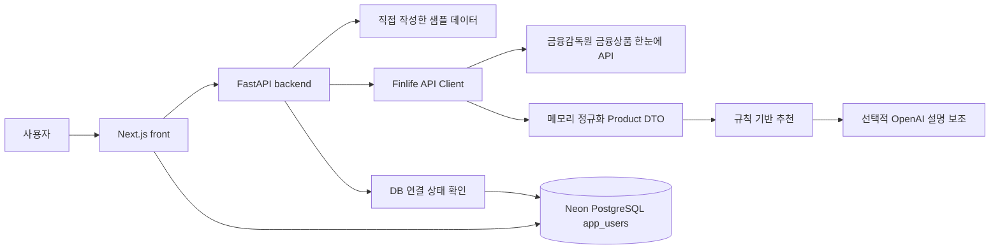

# 아키텍처

## 현재 구조

## 백엔드

`backend/app/main.py`가 FastAPI 진입점입니다.

- `api/`: health, 상품, 추천, 통계 엔드포인트
- `schemas/`: 상품, 추천, AI 설명, DB 상태 모델
- `services/`: 금융감독원 API, 메모리 정규화, 추천 점수, OpenAI 설명 보조, DB 연결 상태 확인
- `data/`: 직접 작성한 로컬 개발용 샘플 상품

## 금융상품 데이터

기본 `sample` 모드는 API 키 없이 직접 작성한 최소 샘플 데이터로 동작합니다.

`finlife` 모드는 금융감독원 API를 요청 시점에 호출하고 메모리에서만 정규화합니다.
응답 원문과 정규화한 상품은 DB나 Git에 저장하지 않습니다. 호출 대상은
`FINLIFE_ALLOWED_BANKS`의 명시적 이름 목록으로 제한합니다.

## OpenAI 설명 보조

추천 순위는 규칙 기반 점수로 결정합니다. OpenAI API는
`OPENAI_EXPLANATIONS_ENABLED=true`이고 API 키가 있을 때만 설명 문구를 보조합니다.
호출 실패, 파싱 실패, 숫자 주장 또는 금지 표현이 있으면 서버 기본 설명으로 되돌아갑니다.

## 데이터베이스 (Neon PostgreSQL)

DB는 Neon 서버리스 PostgreSQL을 사용합니다. 백엔드와 프론트엔드 모두 `DATABASE_URL`
하나로 접속합니다. 스키마는 `database/postgres/schema.sql`입니다.
금융감독원 상품 결과는 저장하지 않으며, 사용자 계정, 애플리케이션 메타데이터,
AI 프롬프트 버전만 저장합니다.

## 프론트엔드

`front/`는 팀원이 만든 Next.js 프로토타입을 기반으로 FastAPI와 연결했습니다.

- 로그인·회원가입은 Neon PostgreSQL의 `app_users` 테이블을 사용합니다.
- 상품 목록·상세·비교 요약·금리 차트·추천 화면은 FastAPI를 호출합니다.
- 기존 SQLite DB와 CSV는 참고용 로컬 파일로만 남기고 Git에서 제외합니다.
- 기존 SQLite 마이그레이션은 `front/prisma/migrations-sqlite-legacy/`에 보존합니다.
