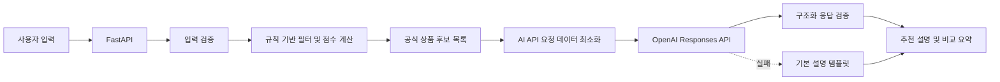

# AI API 연동 기능 계획

## 목적

OpenAI API를 활용하여 금융상품 추천 서비스의 추천 이유 설명과 상품 비교 요약 품질을 높인다.

## 결론

OpenAI API를 사용하는 구조가 적합하다.

다만 금융상품 추천 순위와 공식 데이터는 OpenAI API에 전적으로 맡기지 않는다.
초기 MVP에서는 서버의 규칙 기반 점수화가 추천 순위를 결정하고, OpenAI API는 추천 이유 설명과 비교 요약을 보조한다.

이 구조를 사용하면 다음 장점이 있다.

* 추천 기준을 팀이 설명할 수 있다.
* OpenAI API가 잘못된 금리나 존재하지 않는 상품을 생성하는 위험을 줄일 수 있다.
* OpenAI API가 실패해도 기본 추천 기능을 유지할 수 있다.
* 규칙 기반 추천과 생성형 AI 활용 지점을 명확히 설명할 수 있다.

## OpenAI API 결정

AI API 제공자는 OpenAI API로 확정한다.
초기 구현은 Responses API와 Structured Outputs를 사용한다.
Python SDK의 Pydantic 지원을 활용하여 구조화 응답을 검증한다.

초기 모델 후보는 `gpt-5.4-mini`로 둔다.
공식 모델 문서에 따르면 `gpt-5.4-mini`는 Responses API와 Structured Outputs를 지원하며, 대량 요청을 고려한 효율적인 모델이다.
모델은 `OPENAI_MODEL` 환경변수로 교체할 수 있게 구현한다.

공식 문서:

* Structured Outputs: <https://platform.openai.com/docs/guides/structured-outputs>
* Responses API: <https://platform.openai.com/docs/api-reference/responses/create>
* GPT-5.4 mini: <https://developers.openai.com/api/docs/models/gpt-5.4-mini>

## MVP 적용 범위

### 1. 추천 이유 설명

서버가 계산한 추천 점수와 공식 상품 데이터를 기반으로 사용자에게 읽기 쉬운 설명을 만든다.

예시:

```text
12개월 적금 상품 중 입력한 월 납입액 조건에 맞고,
우대조건이 비교적 단순하여 우선 확인할 상품으로 제안합니다.
가입 전 공식 상품 설명에서 우대금리 적용 조건을 확인해 주세요.
```

### 2. 상품 비교 요약

사용자가 선택한 상품의 차이를 요약한다.

예시:

* 기본 금리가 높은 상품
* 우대조건 충족 시 유리한 상품
* 가입 방식이 단순한 상품
* 사용자가 추가로 확인해야 할 조건

### 후속 기능: 사용자 조건 해석

자연어 요구사항을 내부 필터 조건으로 변환하는 기능은 MVP 완료 후 검토한다.

## MVP 제외 범위

초기에는 다음 항목을 AI API에 맡기지 않는다.

* 공식 상품 데이터 수집
* 상품명, 금융기관명, 금리 수치 생성
* 최종 추천 순위 단독 결정
* 투자 또는 가입 결정을 대신하는 확정적 조언
* 실제 사용자 개인정보 분석

## 권장 구조



## 보안 규칙

* OpenAI API Key는 `.env`에 저장한다.
* `.env`는 Git에 커밋하지 않는다.
* 프론트엔드 JavaScript에서 OpenAI API를 직접 호출하지 않는다.
* API Key를 코드, 문서, 로그, Pull Request에 기록하지 않는다.
* OpenAI API에는 필요한 최소 정보만 전달한다.
* 주민등록번호, 계좌번호, 전화번호, 이메일 등 실제 개인정보를 전달하지 않는다.
* 사용자 입력과 AI 응답을 로그로 남길 때 민감 정보를 제거한다.

환경변수 예시:

```text
OPENAI_API_KEY=
OPENAI_MODEL=gpt-5.4-mini
OPENAI_TIMEOUT_SECONDS=15
```

## 데이터 사용 원칙

OpenAI API 입력은 공식 금융상품 데이터와 내부 계산 결과만 사용한다.

전달 가능한 정보 예시:

* 상품명
* 금융기관명
* 상품 유형
* 기본 금리
* 최고 우대금리
* 가입 기간
* 가입 방법
* 우대조건
* 내부 규칙 점수
* 내부 추천 이유 태그

AI가 생성한 설명은 공식 데이터와 구분한다.
공식 데이터와 AI 설명이 충돌하면 공식 데이터를 우선한다.

## 응답 검증

OpenAI API 응답은 자유 형식 문자열보다 Structured Outputs 기반 JSON을 우선 사용한다.

응답 모델 예시:

```json
{
  "summary": "입력한 조건 기준으로 우선 확인할 만한 상품입니다.",
  "reason_tags": ["12개월 조건 일치", "월 납입액 조건 적합"],
  "warnings": ["우대금리 적용 조건을 공식 상품 설명에서 확인해 주세요."],
  "alternatives": []
}
```

백엔드는 다음을 확인한다.

* 필수 필드 존재 여부
* 문자열 길이 제한
* 허용되지 않은 확정 표현 포함 여부
* 공식 데이터에 없는 상품명 또는 금리 생성 여부
* 응답 파싱 실패 여부

## 실패 대응

OpenAI API가 실패해도 추천 API 전체가 실패하지 않도록 한다.

실패 상황:

* 타임아웃
* 인증 오류
* 호출 한도 초과
* OpenAI API 장애
* JSON 파싱 실패
* 검증되지 않은 상품 정보 생성

대응:

1. 서버 로그에 민감 정보 없이 오류를 기록한다.
2. 규칙 기반 추천 결과는 그대로 반환한다.
3. 설명은 서버의 기본 템플릿으로 생성한다.
4. 사용자에게 AI API 내부 오류를 그대로 노출하지 않는다.

## 비용 및 운영

* 호출 횟수를 측정한다.
* 요청당 토큰 또는 비용을 기록할 수 있도록 한다.
* 동일한 비교 요청을 반복 호출하지 않도록 캐시 도입을 검토한다.
* 개발과 테스트 환경의 사용 한도를 분리한다.
* 모델 또는 프롬프트 변경 시 버전을 기록한다.
* 직접 시연 계획이 없으므로 불필요한 반복 호출을 피하고 개발 중 사용량을 확인한다.

## 구현 단계

### 1. OpenAI API 설정

* [x] OpenAI API 제공자 확정
* [x] OpenAI API Key 발급
* [ ] 비용과 호출 한도 확인
* [x] 데이터 처리 정책 확인
* [x] 초기 모델 `gpt-5.4-mini` 지원 여부 확인

### 2. 백엔드 연동

* [x] 환경변수 정의
* [x] OpenAI Responses API 클라이언트 구현
* [x] 타임아웃과 재시도 정책 구현
* [x] 구조화 응답 모델 구현
* [x] 응답 검증 구현

### 3. 추천 서비스 연결

* [x] 규칙 기반 점수 결과 정의
* [x] OpenAI API 입력 데이터 최소화
* [x] 추천 설명 생성
* [x] 상품 비교 요약 생성
* [x] 기본 설명 템플릿 구현

### 4. 검증

* [ ] 실제 OpenAI API 정상 응답 테스트
* [x] 실제 OpenAI API 쿼터 오류와 fallback 테스트
* [ ] 실제 API 타임아웃 테스트
* [ ] 실제 API 인증 오류 테스트
* [x] 파싱 결과 누락 시 기본 설명 fallback
* [x] 숫자 주장 생성 차단 테스트
* [x] 금지 표현 차단 테스트

## 확인이 필요한 사항

* [x] OpenAI API Key 준비 여부
* [x] 초기 모델 `gpt-5.4-mini` 사용 여부
* [ ] 사용자 입력과 AI 응답 로그 보관 여부

## 작업 결과

2026-06-02 기준으로 OpenAI Responses API 선택적 연동을 구현했다.
추천 순위는 규칙 기반 점수가 결정하고, OpenAI API는 추천 이유와 비교 요약만 보조한다.
`OPENAI_EXPLANATIONS_ENABLED=false`가 기본값이며, Key 누락, API 오류, 검증 실패 시 서버의
기본 설명을 유지한다.

가짜 Responses 클라이언트를 사용해 구조화 설명 적용과 숫자 주장 차단 fallback을 검증했다.
새 API 키로 실제 요청도 수행했다. 요청은 OpenAI API 서버까지 도달했지만 HTTP `429`,
오류 코드 `insufficient_quota`로 응답하여 기본 설명 fallback이 적용되었다.

다음 단계는 OpenAI API 프로젝트의 결제 또는 사용 가능 크레딧을 설정하고
`gpt-5.4-mini`의 실제 한국어 설명 품질과 호출 비용을 확인하는 것이다.

그전까지 로컬 `.env`는 `OPENAI_EXPLANATIONS_ENABLED=false`로 유지한다.
금융감독원 실데이터 조회, MySQL, 규칙 기반 추천과 기본 설명은 OpenAI 호출 없이 검증한다.
