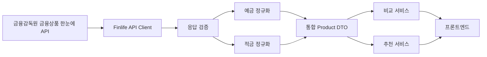

# 금융상품 데이터 수집 기능 계획

## 목적

대한민국 제1금융권의 예금·적금 상품 정보를 수집하고, 비교와 추천에 사용할 수 있는 정규화 데이터로 변환하는 기능을 설계한다.

## 결론

기술적으로 구현 가능하다.

다만 초기 구현은 은행별 웹페이지 직접 크롤링보다 금융감독원 `금융상품 한눈에` 오픈 API 연동을 우선한다.
공식 API 약관에는 제공 정보를 실시간으로 서비스와 연동할 수 있지만 복제, 저장, 전송할 수 없다는 제한이 있다.
별도 저장 허용 문의는 진행하지 않으며, 응답 원문과 정규화 결과를 DB 또는 Git 저장소에 영구 저장하지 않는다.

## 공식 데이터 경로

금융감독원 `금융상품 한눈에`는 REST 방식의 JSON 또는 XML 오픈 API를 제공한다.

* 오픈 API 소개: <https://finlife.fss.or.kr/finlife/main/contents.do?menuNo=700029>
* 인증키 신청: <https://finlife.fss.or.kr/finlife/api/finlifeApiKey/list.do?menuNo=700034>
* 정기예금 API 문서: <https://finlife.fss.or.kr/finlife/api/fdrmDpstApi/list.do?menuNo=700052>
* 적금 API 문서: <https://finlife.fss.or.kr/finlife/api/fdrmEntyApi/list.do?menuNo=700053>

은행 권역 코드는 `020000`이다.

```text
GET https://finlife.fss.or.kr/finlifeapi/depositProductsSearch.json
GET https://finlife.fss.or.kr/finlifeapi/savingProductsSearch.json
```

공통 요청 파라미터:

| 파라미터 | 필수 | 설명 |
| --- | --- | --- |
| `auth` | 필수 | 발급받은 인증키 |
| `topFinGrpNo` | 필수 | 은행 권역 코드 `020000` |
| `pageNo` | 필수 | 페이지 번호 |
| `financeCd` | 선택 | 금융회사 코드 또는 이름 |

## 약관상 주의 사항

금융감독원 오픈 API 약관을 구현 전에 다시 검토해야 한다.

* 인증키는 신청자만 사용한다.
* 개인 인증키는 1일 조회 수 제한이 있다.
* API 제공 정보를 왜곡하거나 사용자가 오인하도록 표시하면 안 된다.
* API 결과 화면에는 금융감독원 금융회사 상품정보를 사용했다는 점을 표시해야 한다.
* API 정보의 복제, 저장, 전송 제한이 있으므로 원문 응답을 영구 보관하지 않는다.
* DB 영구 저장, 데이터셋 배포, 팀원 간 인증키 공유는 하지 않는다.

## 권장 구조

초기 MVP는 공식 API 응답을 요청 시점에 가져와 메모리에서 정규화하고 비교·추천 로직에 전달한다.



### 저장 정책

* 금융감독원 API 원문은 영구 저장하지 않는다.
* 정규화 결과도 영구 저장하지 않는다.
* 응답은 요청 처리 중 메모리에서만 사용한다.
* Git 저장소에 금융감독원 API 응답 샘플 JSON을 추가하지 않는다.
* 테스트 fixture가 필요하면 공식 API 응답을 복제하지 않고 직접 작성한 최소 샘플 데이터를 사용한다.

## 정규화 데이터 초안

정규화 결과는 API 원문과 구분한다.

```text
Product
  source
  source_product_code
  source_company_code
  product_type
  bank_name
  product_name
  join_way
  join_member
  special_conditions
  maturity_interest
  notes
  disclosure_month
  disclosed_at
  source_url

ProductOption
  source_product_code
  interest_type
  saving_type
  term_months
  base_rate
  max_rate
```

정규화 원칙:

* 예금과 적금의 공통 필드는 `Product`로 통합한다.
* 기간별 금리 옵션은 `ProductOption`으로 분리한다.
* 금리는 숫자로 변환한다.
* 값이 없으면 `0`이 아니라 `null`로 유지한다.
* 우대조건과 유의사항 원문은 변경하지 않는다.
* 추천을 위해 파생한 태그와 점수는 공식 데이터가 아닌 내부 계산값임을 구분한다.
* 정규화 결과는 요청 처리 중 메모리에서만 사용한다.

## 제1금융권 범위 확인

`020000` 은행 권역을 기본 범위로 사용한다.

`020000` 응답을 그대로 모두 노출하지 않고 허용 목록을 적용한다.

MVP 포함:

* 시중은행
* 인터넷전문은행

MVP 제외:

* 특수은행
* 지방은행
* 외국계 은행 국내 지점
* 저축은행

저축은행은 별도 권역 코드 `030300`이므로 조회 대상에서도 제외한다.
지정 시중은행과 인터넷전문은행의 구체적인 허용 목록은 코드와 문서에 명시한다.
실제 개인 인증키를 발급받은 뒤 API 응답의 금융회사명과 일치하는지 최종 검증한다.

## 직접 크롤링 사용 기준

은행별 웹페이지 직접 크롤링은 MVP 범위에서 제외한다.
후속 검토가 필요하면 대상 사이트의 정책을 먼저 확인한다.

예시:

* 이벤트성 상세 우대조건
* 상품 설명 페이지의 추가 안내
* 공식 가입 페이지 URL

직접 크롤링 전 확인할 사항:

* 대상 사이트 이용약관
* robots 정책
* 요청 빈도 제한
* HTML 구조 변경 가능성
* 수집 데이터 저장과 재사용 허용 범위
* 출처 URL과 수집 시각 기록 방식

## 구현 단계

### 1. 데이터 이용 조건 확정

* [x] 금융감독원 오픈 API 약관 검토
* [x] 제1금융권 노출 범위 확정
* [x] 구체적인 은행 허용 목록 작성
* [x] 개인 유형 인증키 신청

### 2. API 연동 MVP

* [x] `.env.example`에 `FINLIFE_API_KEY` 추가
* [x] 인증키를 환경변수로만 읽도록 구현
* [x] 예금 API 클라이언트 구현
* [x] 적금 API 클라이언트 구현
* [x] 페이지네이션 구현
* [x] API 오류와 타임아웃 처리

### 3. 정규화

* [x] 공통 DTO 정의
* [x] 예금 응답 정규화
* [x] 적금 응답 정규화
* [x] 숫자와 결측값 변환
* [x] 공시 시점과 출처 표시
* [x] 정규화 테스트 추가

### 4. 서비스 연결

* [x] 상품 목록 API 연결
* [x] 상품 필터 연결
* [x] 비교 서비스 연결
* [x] 추천 서비스 연결
* [x] 화면에 공식 출처 표시

### 5. 추가 데이터 검토

* [ ] 공식 API에서 부족한 필드 목록 작성
* [ ] 부족한 필드는 화면에서 미제공 상태로 명확히 표시
* [ ] 직접 크롤링은 MVP 완료 후 별도 계획으로 검토

## 검증 방법

인증키 발급 후 다음 항목을 확인한다.

* 은행 권역 `020000` 요청이 정상 동작하는가?
* 예금과 적금 페이지네이션이 마지막 페이지까지 처리되는가?
* API 오류와 타임아웃이 서비스 전체 장애로 이어지지 않는가?
* 결측 금리가 `null`로 처리되는가?
* 공식 데이터와 내부 추천 점수가 명확히 구분되는가?
* 화면에 금융감독원 금융회사 상품정보 사용 사실이 표시되는가?

## 필요한 준비물

실제 금융감독원 API 연결에 필요한 준비를 완료했다.

## 작업 결과

2026-06-02 기준으로 공식 API 엔드포인트 접근 가능 여부를 확인했다.
유효하지 않은 인증키를 사용하면 API는 HTTP `200`과 함께 `err_cd: "010"`, `err_msg: "미등록 인증키"`를 반환한다.
API 클라이언트, 페이지네이션, 메모리 정규화, 허용 은행 필터와 테스트를 구현했다.
허용 은행 정책 목록을 코드에 명시했다.
2026-06-02에 개인 인증키로 실제 예금·적금 응답과 허용 은행 필터를 확인했다.
금융감독원 표기인 `주식회사 하나은행` 별칭을 반영했다.
검증 중 응답 원문과 정규화 상품은 파일 또는 DB에 저장하지 않았다.
