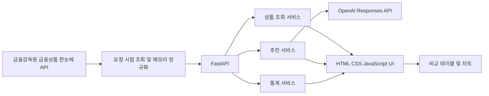

# 졸업 프로젝트 계획서

## 문서 정보

* 프로젝트명: AI 기반 금융상품(예금·적금) 비교 및 맞춤 추천 웹 서비스
* 작성일: 2026-06-02
* 기준 자료: [`졸업프로젝트ppt.pptx`](../../졸업프로젝트ppt.pptx)
* 문서 상태: PPT 기반 개발 계획 초안
* 주의 사항: 이 문서는 현재 구현 완료 목록이 아니다. KPI와 역할 분담은 팀 확인 후 갱신한다.

## 목적

여러 금융기관에 흩어진 예금·적금 상품 정보를 한곳에 모아 비교하고, 사용자의 연령, 직업, 가입 목적, 가입 기간, 금리 선호 조건 등을 반영하여 적합도가 높은 상품을 추천하는 웹 서비스를 개발한다.

서비스는 단순히 추천 목록만 제공하지 않고 다음 질문에 답할 수 있어야 한다.

* 어떤 조건이 상품 비교에 사용되었는가?
* 왜 특정 상품이 추천되었는가?
* 우대금리와 가입 조건 중 사용자가 확인해야 할 내용은 무엇인가?
* 상품별 금리와 특성을 표와 차트에서 어떻게 비교할 수 있는가?

## 현재 상태

현재 저장소는 초기 문서화와 GitHub 협업 환경 설정 단계이다.

완료된 항목:

* [x] 로컬 Git 저장소 초기화
* [x] GitHub 원격 저장소 연결
* [x] 에이전트 작업 규칙 작성
* [x] GitHub 협업 규칙 작성
* [x] 팀원용 GitHub 협업 지침서 작성
* [x] PPT 기반 프로젝트 계획 초안 작성

아직 구현되지 않은 항목:

* [ ] 백엔드 애플리케이션
* [ ] 프론트엔드 애플리케이션
* [ ] 금융상품 데이터 수집 파이프라인
* [ ] 데이터베이스 스키마
* [ ] 상품 비교 API
* [ ] 추천 API와 추천 이유 설명
* [ ] 통계 시각화
* [ ] 테스트와 배포 환경

## 문제 정의

PPT는 다음 문제를 해결 대상으로 제시한다.

| 문제 | 내용 |
| --- | --- |
| 정보 과다 | 금융사별 예금·적금 상품 조건이 흩어져 있어 최신성과 신뢰성을 확인하기 어렵다. |
| 비교의 어려움 | 금리, 우대조건, 중도해지, 가입 기간 등 여러 항목을 직접 비교하는 데 시간이 많이 든다. |
| 사용자 부담 | 연령, 직업 등 개인 조건을 반영한 추천이 부족하여 의사결정 피로가 발생한다. |
| 데이터 신뢰성 | 공식 출처 기반 데이터와 갱신 기준이 명확한 비교 서비스가 필요하다. |

## 핵심 목표

### 사용자 가치

* 예금·적금 상품을 하나의 화면에서 검색하고 비교한다.
* 금리, 우대조건, 가입 기간 등 핵심 조건을 기준으로 필터링한다.
* 사용자 조건을 반영하여 적합도가 높은 상품을 우선 제시한다.
* 추천 이유, 확인할 조건, 주의 사항을 함께 보여준다.
* 금리 추이와 상품 특성 분포를 차트로 시각화한다.

### 데이터 가치

* 공식 출처 기반 수집을 우선한다.
* 크롤링 데이터와 더미 데이터를 명확히 구분한다.
* API 응답 처리 중 수집 시각, 갱신 시각, 출처 URL을 함께 관리한다.
* 중복, 결측값, 오래된 데이터를 식별하고 처리한다.

### 졸업작품 가치

* 발표 자료에서 데이터 수집, 비교, 추천, 설명, 시각화 흐름을 설명할 수 있어야 한다.
* 추천을 확정적인 금융 조언으로 표현하지 않는다.
* 실제 서비스 확장을 고려하되, 먼저 동작하는 MVP를 완성한다.

## 작업 범위

### MVP 범위

1. 금융상품 데이터 로딩 또는 수집
2. 데이터 정제와 중복 처리
3. 상품 목록 조회와 상세 조회
4. 조건 기반 검색과 필터링
5. 상품 비교 테이블
6. 규칙 기반 추천 점수 계산
7. 추천 이유와 주의 사항 설명
8. 금리와 상품 특성 통계 차트
9. 로딩, 오류, 빈 결과 처리
10. 실행 방법과 주요 사용자 흐름 문서화

### 후속 확장 범위

* 인증과 로그인
* 캐시 서버
* 간단한 머신러닝 기반 추천 보정
* 예금·적금 외 금융상품 확대
* 금리 데이터 실시간 갱신 강화
* A/B 테스트
* 배포 자동화
* Prometheus 기반 모니터링
* ELK Stack 기반 로깅
* 필요성이 확인된 서비스의 분리 배포

## 제외 범위

초기 MVP에서는 다음 항목을 필수 완료 조건으로 두지 않는다.

* 금융 수익 보장 또는 가입 의사결정 대행
* 복잡한 머신러닝 모델
* 초기 단계부터의 마이크로서비스 분리
* 모든 금융기관과 모든 금융상품 지원
* 실제 사용자 개인정보 저장
* 운영 수준의 고가용성 인프라

## 주요 기능

| 기능 | MVP 설명 | 후속 확장 |
| --- | --- | --- |
| 상품 비교 | 금리, 우대조건, 가입 기간 등 조건별 필터, 정렬, 비교 | 비교 항목 확대, 실시간 반영 강화 |
| 맞춤 추천 | 사용자 조건 매칭과 가중치 기반 규칙 점수화, AI API 기반 보조 설명 | AI API 활용 고도화, 개인화 개선 |
| 통계 시각화 | 금리 차트, 상품 특성 분포, 추천 근거 강조 | 분석 지표 확대 |
| 결과 설명 | 추천 이유 태그, 조건별 설명, 주의 사항 | 민감도 분석, 조건 변경 시 대안 제시 |

## 권장 시스템 구조

PPT는 데이터, 서비스, 프론트엔드의 3계층 구조와 향후 마이크로서비스 확장을 제안한다.
초기 MVP에서는 개발 속도와 운영 단순성을 위해 계층을 분리한 모듈형 모놀리스를 우선 적용한다.



### 데이터 레이어

* 금융감독원 `금융상품 한눈에` API
* 요청 시점 조회
* 메모리 기반 데이터 정제와 검증
* 공식 API 원문과 정규화 결과의 영구 저장 금지
* 은행별 직접 크롤링은 MVP에서 제외

### 서비스 레이어

* FastAPI 기반 REST API
* 상품 조회와 비교
* 규칙 기반 추천 점수 계산
* OpenAI API를 통한 추천 설명과 비교 요약 보조
* 통계 집계
* 인증, 캐시 서버는 필요성이 확인되면 후속 도입

### 프론트엔드 레이어

* HTML, CSS, JavaScript
* Bootstrap
* Chart.js
* 상품 필터, 비교 테이블, 추천 결과 카드, 통계 차트

## 기술 스택

| 영역 | 기술 |
| --- | --- |
| Backend | Python, FastAPI, Pydantic |
| 데이터 수집 | requests, BeautifulSoup |
| 데이터 분석 | pandas, numpy |
| AI 연동 | OpenAI Responses API, Structured Outputs, 초기 모델 후보 `gpt-5.4-mini` |
| 추천 보정 후보 | 규칙 기반 추천 유지, 후속 단계에서 별도 검토 |
| Frontend | HTML, CSS, JavaScript, Bootstrap, Chart.js |
| Database | MySQL |
| 개발 도구 | VS Code, Git, Postman |
| 배포 후보 | Docker, AWS EC2 |
| 운영 후보 | Prometheus, ELK Stack |

## 데이터 계획

### 수집 대상

* 상품명
* 금융기관명
* 상품 유형: 예금 또는 적금
* 기본 금리
* 최고 우대금리
* 가입 기간
* 최소 가입 금액
* 최대 가입 금액
* 가입 대상
* 우대조건
* 중도해지 관련 안내
* 공식 상품 URL
* 수집 시각과 갱신 시각

### 데이터 처리 원칙

* 공식 출처 URL을 API 응답에 함께 포함한다.
* 금리는 숫자 타입으로 저장한다.
* 값이 없으면 `0`으로 바꾸지 않고 `null`로 처리한다.
* 더미 데이터는 실제 수집 데이터와 구분한다.
* 중복 상품 식별 기준을 설계한다.
* 수집 실패가 전체 서비스 장애로 이어지지 않도록 예외 처리한다.
* 금융감독원 API 원문과 정규화 결과를 DB 또는 Git 저장소에 영구 저장하지 않는다.
* MySQL에는 앱 설정, 내부 메타데이터, 팀이 직접 작성한 샘플 데이터처럼 저장이 허용된 데이터만 보관한다.

## 추천 계획

초기 추천 순위는 규칙 기반 점수화를 사용한다.
OpenAI API는 공식 데이터와 규칙 점수 결과를 입력으로 받아 추천 이유 설명과 비교 요약을 보조한다.
AI API가 공식 상품 정보나 금리 수치를 임의로 생성하도록 하지 않는다.

점수 후보 요소:

* 기본 금리
* 최고 우대금리
* 가입 기간 적합성
* 최소 및 최대 가입 금액
* 우대조건 충족 가능성
* 사용자의 연령대
* 사용자의 직업
* 사용자의 가입 목적
* 상품 유형
* 가입 난이도
* 조건 설명의 명확성

추천 결과에는 다음 정보를 포함한다.

```json
{
  "product_id": 1,
  "product_name": "상품명",
  "bank_name": "은행명",
  "score": 87.5,
  "reason_tags": ["높은 금리", "조건 일치", "가입기간 적합"],
  "explanation": "입력한 조건 기준으로 적합도가 높은 상품입니다.",
  "warnings": ["가입 전 공식 상품 설명과 우대조건을 확인해야 합니다."]
}
```

AI API 연동 상세 계획은 [`2026-06-02-ai-api-integration.md`](./2026-06-02-ai-api-integration.md)를 따른다.

## API 초안

실제 구현 과정에서 변경될 수 있다.

```text
GET  /api/health
GET  /api/products
GET  /api/products/{product_id}
GET  /api/products/compare
POST /api/recommendations
GET  /api/stats/rates
GET  /api/stats/products
```

## 연구 및 구현 단계

PPT의 5단계 연구 방법론을 개발 작업 흐름에 맞게 정리한다.

### 1. 선행연구 및 사례 조사

* [ ] 금융상품 비교·추천 서비스 사례 정리
* [ ] 관련 논문과 추천 방식 조사
* [ ] 졸업작품에서 구현할 차별점 확정

### 2. 데이터 수집 및 정제

* [ ] 공식 데이터 출처 후보 조사
* [ ] 수집 대상 필드와 데이터 스키마 정의
* [ ] 금융감독원 공식 API 연동
* [ ] 중복값과 결측값 처리
* [ ] 최신성 검증

### 3. 분석 및 모델링

* [ ] 통계 요약과 데이터 분포 분석
* [ ] 규칙 기반 추천 점수 설계
* [ ] AI API를 사용하지 않는 기본 추천 설명 설계
* [ ] OpenAI API 기반 추천 설명과 비교 요약 기능 설계
* [ ] 자연어 조건 해석은 후속 기능으로 검토

### 4. 평가

* [ ] 정확도와 커버리지 정의
* [ ] 사용자 시나리오 테스트
* [ ] API 성능 측정
* [ ] 추천 설명 품질 확인

### 5. UI 및 UX

* [ ] 화면 프로토타입
* [ ] 상품 목록과 필터
* [ ] 상품 비교 테이블
* [ ] 추천 결과 카드와 설명
* [ ] Chart.js 기반 시각화
* [ ] 사용성 테스트와 반복 개선

## 팀원 역할 분담 초안

PPT에 기재된 역할을 기준으로 작성했다. 담당 범위 변경 시 팀 합의 후 갱신한다.

| 팀원 | 담당 영역 | 주요 업무 |
| --- | --- | --- |
| 김재민 | Frontend | 웹 서비스 UI/UX 설계, 비교·추천 결과와 통계 시각화 화면, 프론트엔드 UI 구현 |
| 신건희 | Backend | Python 기반 데이터 수집과 정제, DB 설계, API 제공, 데이터 기반 구축 |
| 최용현 | Algorithm | 사용자 조건 반영, 상품 분석, 추천 알고리즘 공동 설계, 통계 기반 만족도 지표 도출 |
| 허영근 | Algorithm | 사용자 조건 반영, 상품 분석, 추천 알고리즘 공동 설계, 통계 기반 만족도 지표 도출 |

## KPI 후보

PPT에는 서로 다른 슬라이드에서 여러 목표 수치가 제시되어 있다.
현재는 측정 기준과 데이터셋이 확정되지 않았으므로 구현 완료 기준이 아닌 **후보 KPI**로 관리한다.

| 영역 | PPT 제시값 | 계획 문서 처리 |
| --- | --- | --- |
| 의사결정 시간 | 50% 단축 | 사용자 시나리오 정의 후 측정 |
| 정보 신뢰도 | 80% 향상, 95% 이상, 99% 이상 | 데이터 출처와 최신성 기준을 먼저 정의 |
| 추천 정확도 | 85%, 95% 이상 | 정답 데이터와 평가 방식을 먼저 정의 |
| 비교 완료율 | 80% 이상 | UI 이벤트 측정 방식 정의 후 평가 |
| 사용자 만족도 | 4.5/5, 90% 이상, 92% | 설문 문항과 표본 기준 정의 후 평가 |
| 이용률 | 75% 이상 | 이용률의 분모와 측정 기간 정의 |
| 재방문율 | 60% 이상, 75% | 측정 기간과 사용자 식별 방식 정의 |
| API 응답 시간 | 1초 미만 | 로컬과 배포 환경을 구분하여 측정 |
| 시스템 가용성 | 99.9% | 운영 단계 목표로 분리 |
| 오류율 | 0.1% 미만 | 오류 정의와 수집 방식을 먼저 정의 |

MVP 단계에서는 다음 항목을 우선 검증한다.

* 수집 데이터에 출처 URL이 포함되는가?
* 최신 데이터와 더미 데이터가 구분되는가?
* 상품 필터와 비교가 정상 동작하는가?
* 추천 결과에 이유와 주의 사항이 포함되는가?
* 주요 API가 테스트 시나리오에서 정상 응답하는가?
* 주요 사용자 흐름이 정상적으로 동작하는가?

## 위험 요소 및 확인이 필요한 사항

### 데이터

* [ ] 금융감독원 API 개인 유형 인증키를 신청해야 한다.
* [ ] 요청 시점 조회의 타임아웃과 장애 대응 방식을 구현해야 한다.
* [ ] 중도해지, 우대조건처럼 구조화하기 어려운 데이터를 어떻게 표현할지 결정해야 한다.

### 추천

* [ ] 추천 정확도의 정의와 정답 데이터 확보 방법을 결정해야 한다.
* [ ] 사용자 연령과 직업 정보를 실제로 저장할지, 요청 시점에만 사용할지 결정해야 한다.
* [ ] 추천 가중치와 설명 문구를 팀에서 검토해야 한다.

### 구조

* [ ] 초기 구현은 모듈형 모놀리스로 진행하고, 마이크로서비스 분리는 필요성을 검토한 뒤 결정한다.
* [ ] MySQL 실행 방식을 Docker Compose 또는 팀원 로컬 설치 중 하나로 결정해야 한다.

### 협업

* [ ] 팀원별 상세 작업 티켓을 GitHub Issue로 등록해야 한다.
* [ ] `main`과 `develop` 브랜치 보호 정책을 GitHub에서 설정해야 한다.

## 검증 방법

구현 후 다음 순서로 검증한다.

```bash
python --version
pip install -r requirements.txt
python -m compileall .
python -m pytest
```

추가 검증:

* Postman 또는 자동화 테스트로 API 응답 확인
* 상품 필터와 비교 결과 확인
* 추천 이유와 경고 문구 확인
* 차트 렌더링 확인
* 데이터 출처 URL과 수집 시각 확인
* 주요 사용자 흐름 확인

## 작업 결과

2026-06-02 기준으로 PPT의 내용을 개발 가능한 계획 구조로 문서화했다.
다음 단계는 팀 확인이 필요한 항목을 확정하고, GitHub Issue로 초기 작업을 분리하는 것이다.
